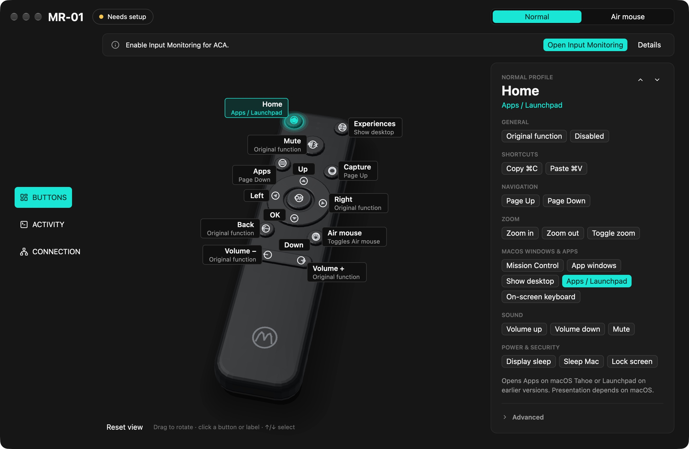

# ACA — Air Controller Adapter

Customize your **Motorola Ready For Air Remote MR-01** with a native Mac app built in Rust and GPUI. Assign actions to buttons, switch between Normal, Air mouse and Keyboard mappings, and try ACA's own virtual keyboard.

**An independent project, not affiliated with or endorsed by Motorola.** Device names identify compatibility.



## Keyboard preview

[**Download v0.1.0-preview.4**](https://github.com/facundoPri/air-controller-adapter/releases/tag/v0.1.0-preview.4) · [Release notes](RELEASE_NOTES.md) · [All releases](https://github.com/facundoPri/air-controller-adapter/releases)

Download `ACA-v0.1.0-preview.4-macos-arm64.zip` under **Assets**. The source archives are not applications. This experimental Apple Silicon release includes one **ACA.app**, its embedded managed reader, and the virtual keyboard feature. It replaces the earlier two-app packaging. There are no Intel, Windows or Linux binaries.

The app is signed with an **Apple Development** certificate, not Developer ID, and is **not notarized**. Gatekeeper may block it. Fresh-machine installation and permission setup have not been validated. The bundle declares macOS 13 as its minimum; earlier macOS versions than the development machine have not been fully tested.

The keyboard implementation and automated tests are available, but native text insertion in TextEdit, browsers and terminals, full MR-01 keyboard navigation, and panel behavior across displays/Spaces/fullscreen remain unverified. Physical Left/Right reports were received by an earlier signed QA candidate after restarting the reader; that does not validate the full keyboard or this release artifact. Treat this as a testing preview, not a fully validated replacement for a working installation.

## Install and connect

1. Back up `~/Library/Application Support/ReadyForAirLab/` before upgrading. Keep your previous application and configuration backup for rollback.
2. If using an existing single-app candidate, choose **Disconnect**, wait for cleanup, then **Connection → Diagnostics → Remove background service** and wait for success before quitting or replacing it. Quitting alone leaves the service registered. Quit both apps if upgrading from the legacy Studio/Capture pair.
3. Extract the ZIP and move the complete `ACA.app` to a stable location such as Applications. Keep the embedded reader inside the app. Do not run older ACA versions alongside it.
4. Open ACA. If macOS blocks it, follow [Apple's instructions for opening an app from an unidentified developer](https://support.apple.com/102445). If **Open Anyway** is unavailable, record the message; do not disable Gatekeeper globally.
5. In **Connection**, choose **Enable ACA** to register the embedded reader. Approve its background service in macOS Login Items & Extensions if requested.
6. Grant Input Monitoring to ACA and its embedded **ACA Reader.app**, and Accessibility to ACA. The reader is inside `ACA.app/Contents/Library/Helpers/`; use Finder's **Show Package Contents** if it must be added manually. This setup flow is still unfinished. Bluetooth and Automation may also be requested for their respective features.
7. For a new remote, hold **Back + OK** until the LED flashes. Choose **Connection → Pair a remote** to search directly, even when the MR-01 is absent from Bluetooth Settings. **Search again** retries a failed search inside ACA. These controls preserve mappings and macOS pairings while clearing ACA’s previous device selection. Check actual button activity: a BLE link or authenticated reader alone does not establish working capture.

After granting reader Input Monitoring, **Retry** may retain a stale Denied result. If that happens, disconnect, wait for cleanup, remove the background service through Diagnostics, and explicitly enable it again. A real reader restart recovered the observed QA instance. Avoid repeated permission toggling.

## Use the virtual keyboard

1. In **Buttons**, select a button and the **Normal** or **Air mouse** profile. Assign **Toggle keyboard**; Home or Capture are convenient choices. Assignments save automatically.
2. Open **Keyboard** settings to choose English or Spanish, QWERTY or alphabetical layout, size and opacity. **Toggle preview** shows a non-typing preview. Drag the panel header to reposition it.
3. Focus a disposable text field in another app and press the assigned remote button. Alternatively, choose **Test in another app in 5 seconds** and focus that field before the timer expires. Accessibility and an observable destination window/field are required.
4. The Keyboard profile defaults to arrows for navigation, OK to select, and Back to delete. The opening button closes the keyboard. Pointer clicks are also implemented, with native acceptance still pending.
5. Return sends once and closes the panel. Tab also sends once and closes; reopen in the next field. Verified continuation after Tab is not implemented. An external target change or unverifiable focus cancels the session.

Existing **On-screen keyboard** assignments remain the legacy macOS Accessibility Keyboard action. They are not silently converted; select **Toggle keyboard** to try ACA's own panel. Custom shortcut recording and the full planned shortcut catalog are not part of this preview.

## Configure buttons

Select a button on the 3D model or use the inspector's previous/next controls. Choose **Normal**, **Air mouse**, or **Keyboard** to edit that profile. Editing a profile does not change the remote's firmware mode. The physical Air mouse button has no confirmed independent press event and cannot be remapped.

Presets include Mission Control, app windows, desktop, apps, volume, zoom, Page Up/Down, locking, sleep, display sleep and keyboard actions. **Zoom requires keyboard shortcuts to be enabled in Accessibility → Zoom**. Shortcuts, AppleScript, shell commands and macros can also be configured through **Connection → Configuration JSON**. Saving does not execute an action. If saving fails, ACA preserves the previous configuration and displays the error.

**Edit mappings offline** works without a connected remote. **Follow movement** animates the model from relative mouse movement; it is an approximate effect, not absolute gyroscope tracking. **Activity** shows events and supports export. Review exported logs before sharing them.

## Configuration and rollback

This keyboard build uses **configuration version 3**. Existing v1/v2 files are backed up to `config.v1.backup.json` or `config.v2.backup.json` before migration. Non-voice mappings are retained; old voice actions, including assignments with nested voice macros, become Disabled. Existing recordings and transcriptions are left untouched. Invalid or future configurations are rejected without resetting them. `config.previous.json` preserves the preceding configuration on saves.

Older builds cannot read v3. To roll back, first remove the new background service and quit ACA, preserve the current data folder, then restore your pre-upgrade configuration backup and previous complete application. Do not mix reader and app builds.

To uninstall, disconnect, wait for cleanup, remove the background service in Diagnostics, wait for success and quit. Delete ACA and its permission entries. Keep the data folder unless you also want to remove your configuration and historical recordings.

## Known limits

- Native keyboard insertion and the full physical remote routing matrix remain unverified. Automated tests do not establish native readiness.
- Tab continuation, the complete settings/lifecycle matrix and connected CPU measurements remain outstanding.
- Reader permission recovery may require a service restart; unified permission onboarding needs more work.
- The signed download is a development preview with no notarization or fresh-machine acceptance.

When [reporting an issue](https://github.com/facundoPri/air-controller-adapter/issues), include the release/build, macOS version, Mac model, target app, button/profile/action and exact error. Do not include private text or configuration secrets.

## Build and test

Development requires macOS, Xcode/Command Line Tools and Rust. `script/cargo.sh` uses Cargo in PATH or `READY_AIR_RUST_TOOLCHAIN`. It also supports an ignored `.tools/rust-toolchain-path` file.

```sh
sh script/cargo.sh test --locked --features managed-reader,virtual-keyboard
sh script/cargo.sh test --locked --features managed-reader
sh script/cargo.sh test --locked
```

Build into a new directory with the keyboard explicitly enabled and an available Apple signing certificate:

```sh
ACA_VIRTUAL_KEYBOARD=1 ACA_BUILD_ID=v0.1.0-preview.4 \
READY_AIR_PROFILE=release READY_AIR_DIST="$PWD/dist/preview.4" \
READY_AIR_SIGN_IDENTITY='<Apple signing identity>' sh script/build_unified.sh
READY_AIR_DIST="$PWD/dist/preview.4" sh script/package_unified.sh
```

The build refuses to overwrite an existing candidate. Ad-hoc signing cannot enable the managed service. Packaging checks the app and reader signatures, matching build IDs and Apple Silicon architecture, then extracts and verifies the ZIP. It does not install, register or publish anything. The executable supports `--build-info`, `--verify-capture`, `--service-status` and a bounded `--probe-reader` diagnostic that reads reports without executing mappings. Probe builds cannot be packaged for use.

## License

An open-source license has not yet been selected for the project's own code. Dependencies retain their licenses; their notices are included in the download. Third-party license texts and author names are preserved as supplied upstream.
